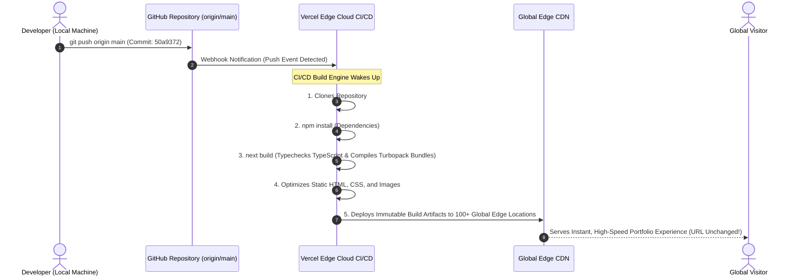

# 📘 The Definitive Portfolio Engineering Documentation & Interview Guide

> **Author:** Prudhvi Reddy  
> **Project:** Next-Gen 3D Interactive Multilingual Portfolio  
> **Production URL:** [https://prudhvi-portfolio-zeta.vercel.app](https://prudhvi-portfolio-zeta.vercel.app)  
> **Source Repository:** [github.com/prudhvi05reddy/prudhvi-portfolio](https://github.com/prudhvi05reddy/prudhvi-portfolio)  
> **Target Audience:** Developers, Interviewers, Tech Leads, and Beginners seeking a comprehensive understanding of production-grade modern web development.

---

## 📑 Table of Contents
1. [Executive Summary & The Beginner Mental Model](#1-executive-summary--the-beginner-mental-model)
2. [Complete Technology Stack: What It Is & Why It Was Chosen](#2-complete-technology-stack-what-it-is--why-it-was-chosen)
3. [System Architecture & Data Flow Pipelines](#3-system-architecture--data-flow-pipelines)
4. [File & Folder Structure Breakdown](#4-file--folder-structure-breakdown)
5. [Line-by-Line & Component-by-Component Deep Dive](#5-line-by-line--component-by-component-deep-dive)
   - [5.1 `app/layout.tsx` (Application Skeleton)](#51-applayouttsx-application-skeleton)
   - [5.2 `app/page.tsx` (Home Orchestrator)](#52-apppagetsx-home-orchestrator)
   - [5.3 `components/GreetingIntro.tsx` (Multilingual Splash)](#53-componentsgreetingintrotsx-multilingual-splash)
   - [5.4 `components/LanguageContext.tsx` & `LanguageSwitcher.tsx` (i18n & RTL)](#54-componentslanguagecontexttsx--languageswitchertsx-i18n--rtl)
   - [5.5 `components/ThemeContext.tsx` & `ThemeToggle.tsx` (Theme Engine)](#55-componentsthemecontexttsx--themetoggletsx-theme-engine)
   - [5.6 `components/Hero.tsx` (Responsive 3D Hero)](#56-componentsherotsx-responsive-3d-hero)
   - [5.7 `components/Navbar.tsx` (Floating Glass Dock)](#57-componentsnavbartsx-floating-glass-dock)
   - [5.8 `components/About.tsx` (Story, Projects & 3D Tilt Modals)](#58-componentsabouttsx-story-projects--3d-tilt-modals)
   - [5.9 `components/TextReveal.tsx` (Scroll-Tied Word Reveals)](#59-componentstextrevealtsx-scroll-tied-word-reveals)
   - [5.10 `components/Skills.tsx` (Filter Matrix & Certificate Modal)](#510-componentsskillstsx-filter-matrix--certificate-modal)
   - [5.11 `components/Experience.tsx` (Timeline & Achievements)](#511-componentsexperiencetsx-timeline--achievements)
   - [5.12 `components/Contact.tsx` (Glassmorphic Contact Card)](#512-componentscontacttsx-glassmorphic-contact-card)
   - [5.13 3D Graphics Engine (`Background3D`, `FloatingHexagons`, `HexWall`, `Cubes`)](#513-3d-graphics-engine-background3d-floatinghexagons-hexwall-cubes)
   - [5.14 `components/ScrollingSkills.tsx` (Infinite Marquee)](#514-componentsscrollingskillstsx-infinite-marquee)
   - [5.15 `app/globals.css` (Design System & CSS Tokens)](#515-appglobalscss-design-system--css-tokens)
6. [Browser APIs & Lower-Level Web Technologies Used](#6-browser-apis--lower-level-web-technologies-used)
7. [The Mobile Responsiveness Engineering Case Study](#7-the-mobile-responsiveness-engineering-case-study)
8. [Comprehensive Interview Questions & Answers (Junior to Senior)](#8-comprehensive-interview-questions--answers-junior-to-senior)
9. [DevOps, Git & CI/CD Deployment Pipeline](#9-devops-git--cicd-deployment-pipeline)

---

## 1. Executive Summary & The Beginner Mental Model

### What is this project?
This portfolio is a **hyper-modern, high-performance web application** designed to showcase software engineering, data science, and business intelligence capabilities. Rather than building a static, boring webpage, this project combines **3D WebGL graphics**, **real-time spring physics**, **glassmorphism styling**, **multilingual internationalization**, and **instant theme swapping** into a unified experience.

### The "House" Analogy (Explain Like I'm 5)
If you think of this portfolio as a futuristic high-tech house:
* **Next.js 16 (App Router)** is the **Architect and Concrete Foundation**. It structures the rooms, handles visitors arriving at the front door, and ensures the walls are rock-solid and energy-efficient.
* **React 19** is the **Smart Home Automation System**. When you tap a button on the wall (state changes), only the light in that room turns on without rebuilding the entire house.
* **TypeScript 5** is the **Strict Building Inspector**. Before a single brick is laid, it verifies that every wire, pipe, and beam matches the exact blueprint, preventing electrical fires (runtime crashes).
* **Tailwind CSS 4** is the **Interior Decorator**. Instead of having to mix paint in custom buckets from scratch, it provides high-end pre-formulated paints, fabrics, and frosted-glass panels.
* **Three.js & React Three Fiber** are the **Hologram Projectors**. They cast floating, responsive 3D geometric shapes into the air that react to sunlight and visitor movement.
* **Framer Motion 12** is the **Hydraulic Spring System** on every door, drawer, and handle. Nothing ever slams shut; every movement has weight, bounce, and inertia.
* **Lenis Scroll** is the **Magnetic Hoverboard**. As you glide down hallways, it replaces jerky walking with frictionless, buttery-smooth gliding.
* **Language & Theme Engines** are the **Universal Environmental Controls**. At the tap of a button, the language changes instantly (even mirroring walls for Arabic Right-to-Left), and the lights dim from daytime solar illumination to nighttime cyberpunk neon.

---

## 2. Complete Technology Stack: What It Is & Why It Was Chosen

| Technology | Category | What It Is | Why It Was Chosen Over Alternatives |
|---|---|---|---|
| **Next.js 16 (App Router)** | Framework | The leading React full-stack production framework by Vercel. | Delivers built-in image optimization (`next/image`), font self-hosting (`next/font`), file-system routing, automatic code splitting, and Turbopack compiler speeds. |
| **React 19** | UI Library | The newest major release of the declarative component library. | Introduces enhanced concurrency, automatic memoization with React Compiler, clean hook lifecycles, and optimal client-side hydration. |
| **TypeScript 5** | Language | Strongly typed superset of JavaScript developed by Microsoft. | Prevents silent `undefined is not a function` bugs, guarantees strict component prop contracts, and provides rich IDE autocompletion. |
| **Tailwind CSS 4** | Styling | Modern utility-first CSS engine with native CSS variable compilation. | Replaces bloated stylesheets with composable utility classes. Tailwind 4 compiles natively with `@tailwindcss/postcss` for zero runtime overhead and minimal CSS bundle size. |
| **Framer Motion 12** | Animation | Production-ready motion and gesture library for React. | Provides spring-based physics (mass, stiffness, damping) rather than robotic linear CSS animations, handles exit animations via `<AnimatePresence />`, and powers scroll progress interpolation. |
| **Three.js & R3F** | 3D Graphics | WebGL library wrapped in declarative React components (`@react-three/fiber`, `@react-three/drei`). | Enables GPU-accelerated rendering of 3D geometry (cylinders, hexagons, meshes, custom materials, lighting) right inside the browser canvas. |
| **GSAP 3** | Animation | GreenSock Animation Platform, the gold standard for timeline animations. | High-performance timeline choreography where extreme frame-rate consistency is essential. |
| **Lenis Scroll** | UX / Physics | Smooth scrolling library by Studio Freight. | Normalizes erratic wheel/trackpad scrolling curves into a smooth linear interpolation (`lerp`), preventing visual stuttering during parallax animations. |
| **Lucide React & React Icons** | Iconography | High-quality, tree-shakeable SVG icon suites. | Clean vector iconography with zero layout shift; only the imported icons are bundled into production. |
| **Biome** | Tooling | High-performance Rust-based linter and formatter. | Executes linting and code formatting in single-digit milliseconds, replacing ESLint and Prettier with a single tool. |
| **Vercel** | Hosting & CI/CD | Global edge application platform. | Automatically builds and deploys upon every `git push` to `main`, provides instant edge caching, and preserves persistent custom domains. |

---

## 3. System Architecture & Data Flow Pipelines

### Application Architecture Diagram

```mermaid
flowchart TD
    subgraph Client Browser [Client Browser Environment]
        User[👤 Visitor / Recruiter] -->|Interacts With UI| BrowserEvents[Mouse, Scroll, Touch, Clicks]
    end

    subgraph State & Context [Global State Providers]
        ThemeCtx["🎨 ThemeContext (Light / Dark) \n- Persisted in localStorage\n- HTML [data-theme] attribute"]
        LangCtx["🌍 LanguageContext (EN, HI, JA, AR) \n- Persisted in localStorage\n- RTL DOM Mirroring"]
    end

    subgraph Root Layout [Next.js App Router Tree]
        Root["app/layout.tsx (RootLayout)"] --> ThemeProvider["<ThemeProvider>"]
        ThemeProvider --> LangProvider["<LanguageProvider>"]
        LangProvider --> Page["app/page.tsx (Home Page)"]
    end

    subgraph UI Component Tree [Page Sections & Visual Layers]
        Page --> Intro{"showIntro State?"}
        Intro -- true --> Splash["GreetingIntro.tsx (Multilingual Splash)"]
        Intro -- false --> MainApp["<main> Layout"]

        MainApp --> Hero["Hero.tsx (3D Video, Avatar, Navigation Bar)"]
        MainApp --> Dock["Navbar.tsx (Floating Glass Dock with Scrollspy)"]
        MainApp --> About["About.tsx (Career Bio, Project Cards, Case Study Modals)"]
        MainApp --> TextRev["TextReveal.tsx (Scroll-Tied Typography Engine)"]
        MainApp --> Exp["Experience.tsx (Timeline Milestones)"]
        MainApp --> SkillsSec["Skills.tsx (Filter Matrix & Certificate PDF Modal)"]
        MainApp --> ContactSec["Contact.tsx (Glassmorphism Card & Action Buttons)"]
    end

    subgraph Background FX [Ambient Visual Shaders]
        Hero -.-> Bg3D["Background3D.tsx (4K Video Loop + CSS Filter Inversion)"]
        Hero -.-> Marquee["ScrollingSkills.tsx (Infinite Framer Marquee)"]
        ContactSec -.-> HexFloats["FloatingHexagons.tsx (Dynamic SVG Springs)"]
    end

    BrowserEvents --> State & Context
    State & Context --> Root Layout
```

---

## 4. File & Folder Structure Breakdown

```
prudhvi-portfolio/
├── app/                                 # Next.js App Router Root
│   ├── favicon.ico                      # Website tab icon
│   ├── globals.css                      # Global Tailwind 4 styles, CSS variables, hex-grid styles
│   ├── layout.tsx                       # Root HTML wrapper, Inter font loader, Context Providers
│   └── page.tsx                         # Primary page orchestrator, intro transition manager
├── components/                          # Modular React Components
│   ├── About.tsx                        # About Me, project cards, 3D card tilts, case study modals
│   ├── AchievementTicker.tsx            # Floating stats ribbon
│   ├── Background.tsx                   # CSS-based hexagon grid fallback
│   ├── Background3D.tsx                 # Hardware-accelerated 4K hexagon loop video with CSS filters
│   ├── Contact.tsx                      # Modern glassmorphism contact section with 4 pill buttons
│   ├── Cubes.tsx                        # Three.js 3D isometric cube grid with wave mathematics
│   ├── Experience.tsx                   # Professional work history timeline with theme-adaptive cards
│   ├── FloatingHexagons.tsx             # Floating SVG geometric polygons with Framer Motion keyframes
│   ├── GreetingIntro.tsx                # Initial multilingual welcome splash sequence
│   ├── Hero.tsx                         # Header, avatar, huge responsive typography, social links
│   ├── HexWall.tsx                      # React Three Fiber 3D cylinder hex wall with sinusoidal wave physics
│   ├── LanguageContext.tsx              # React Context providing active language & translations
│   ├── LanguageSwitcher.tsx             # Multi-language selector pill (EN, HI, JA, AR)
│   ├── Navbar.tsx                       # Floating bottom dock with active scroll-position spy
│   ├── ScrollingSkills.tsx              # Continuous infinite horizontal skill marquee
│   ├── Skills.tsx                       # Interactive categorized skills matrix & certificate preview modal
│   ├── Socials.tsx                      # Reusable social media links
│   ├── TextReveal.tsx                   # Scroll-driven word-by-word opacity reveal
│   ├── ThemeContext.tsx                 # React Context providing dark/light theme state & toggle
│   └── ThemeToggle.tsx                  # Sun/Moon animated theme toggle button
├── data/
│   └── translations.ts                  # Central multilingual dictionary (English, Hindi, Japanese, Arabic)
├── messages/                            # JSON localization assets
│   ├── ar.json                          # Arabic strings
│   ├── en.json                          # English strings
│   ├── hi.json                          # Hindi strings
│   └── ja.json                          # Japanese strings
├── public/                              # Static public assets (images, profile pictures, certificates, icons)
│   ├── profile.png                      # High-res developer portrait
│   └── greetings/                       # Country-specific splash background images
├── package.json                         # Project dependencies, scripts, and engine specifications
├── tsconfig.json                        # TypeScript compiler configurations and path aliases (@/*)
├── next.config.ts                       # Next.js engine options
├── biome.json                           # Biome linter & code formatting rules
└── DOCUMENTATION.md                     # You are reading this complete master guide!
```

---

## 5. Line-by-Line & Component-by-Component Deep Dive

---

### 5.1 `app/layout.tsx` (Application Skeleton)

```tsx
import type { Metadata } from "next";
import { Inter } from "next/font/google";
import "./globals.css";
import { LanguageProvider } from "@/components/LanguageContext";
import { ThemeProvider } from "@/components/ThemeContext";

const inter = Inter({ subsets: ["latin"] });

export const metadata: Metadata = {
  title: "Prudhvi Reddy | Portfolio",
  description: "Software Developer Portfolio",
};

export default function RootLayout({ children }: { children: React.ReactNode }) {
  return (
    <html lang="en">
      <body className={inter.className}>
        <ThemeProvider>
          <LanguageProvider>
            {children}
          </LanguageProvider>
        </ThemeProvider>
      </body>
    </html>
  );
}
```

#### Line-by-Line Breakdown:
* **Line 1–4:** Imports the Next.js `Metadata` type for SEO, the Google `Inter` font optimizer from `next/font/google`, and `globals.css`.
* **Line 5–6:** Imports the application's two master context providers: `LanguageProvider` (for multilingual support) and `ThemeProvider` (for light/dark theme).
* **Line 8–10:** `const inter = Inter({ subsets: ["latin"] });` — Next.js automatically downloads the font at build time and self-hosts it alongside static assets. **Zero Google Fonts tracking requests**, eliminating layout shifts (CLS = 0).
* **Line 12–15:** `export const metadata`: Injects standard HTML `<head>` meta tags (`<title>` and `<meta name="description">`) for SEO and social media link previews.
* **Line 17–33:** `RootLayout`: Wraps the entire document tree in `ThemeProvider` and `LanguageProvider`. This ensures every child component anywhere in the tree can call `useTheme()` and `useLanguage()`.

---

### 5.2 `app/page.tsx` (Home Orchestrator)

```tsx
"use client";

import { useState } from "react";
import Navbar from "@/components/Navbar";
import About from "@/components/About";
import TextReveal from "@/components/TextReveal";
import Experience from "@/components/Experience";
import GreetingIntro from "@/components/GreetingIntro";
import Hero from "@/components/Hero";
import Skills from "@/components/Skills";
import Contact from "@/components/Contact";

export default function Home() {
  const [showIntro, setShowIntro] = useState(true);

  return (
    <>
      {showIntro ? (
        <GreetingIntro onFinish={() => setShowIntro(false)} />
      ) : (
        <main>
          <Hero />
          <Navbar />
          <About />
          <div className="h-[4.0cm]" />
          <TextReveal />
          <div className="h-[150px] sm:h-[180px] lg:h-[200px] pointer-events-none select-none" />
          <Experience />
          <div className="h-[5.25cm]" />
          <Skills />
          <div className="h-[1.25cm]" />
          <Contact />
        </main>
      )}
    </>
  );
}
```

#### Line-by-Line Breakdown:
* **Line 1:** `"use client";` declares this as a Client Component, required because it relies on React state (`useState`) to toggle the intro splash screen.
* **Line 16:** `const [showIntro, setShowIntro] = useState(true);` controls whether the splash screen or the main portfolio is visible.
* **Line 20–22:** Conditional rendering: When `showIntro` is `true`, `GreetingIntro` is displayed. Once it completes its animated cycle, it triggers `onFinish()`, setting `showIntro` to `false`.
* **Line 23–39:** Renders the main portfolio sections sequentially. The calibrated height spacers (`h-[4.0cm]`, `h-[5.25cm]`) ensure that the scroll-tied animations (`TextReveal`) have sufficient vertical scroll runway to execute their transitions smoothly.

---

### 5.3 `components/GreetingIntro.tsx` (Multilingual Splash)

#### What It Does:
When a visitor loads the site, it displays a full-screen cinematic sequence greeting the visitor in multiple languages (**English, Telugu, Hindi, Japanese, Arabic, Spanish**) along with synchronized cultural background imagery before fading into the main website.

```tsx
const greetings = [
  { text: "Hello", image: "/greetings/English.jpeg" },
  { text: "నమస్కారం", image: "/greetings/Telugu.jpeg" },
  { text: "नमस्ते", image: "/greetings/Hindi.jpeg" },
  { text: "こんにちは", image: "/greetings/Japanese.jpeg" },
  { text: "مرحباً", image: "/greetings/Arab.jpeg" },
  { text: "Hola", image: "/greetings/Spanish.jpeg" },
];
```

#### Mechanism:
* Uses a `setInterval` timer (300ms cycle) paired with a `setTimeout` (60ms fade reset) to cycle through the greeting array indices.
* When `index >= greetings.length - 1`, a final 500ms timeout calls `onFinish()`, cleanly unmounting the splash screen.
* Clean return functions in `useEffect` (`clearInterval`, `clearTimeout`) prevent memory leaks if the user leaves early.

---

### 5.4 `components/LanguageContext.tsx` & `LanguageSwitcher.tsx` (i18n & RTL)

#### The Context Engine:
```tsx
export function LanguageProvider({ children }: { children: ReactNode }) {
  const [language, setLanguageState] = useState<Language>("en");

  useEffect(() => {
    const saved = localStorage.getItem("language") as Language | null;
    const languages: Language[] = ["en", "hi", "ja", "ar"];
    if (saved && languages.includes(saved)) {
      setLanguageState(saved);
    }
  }, []);

  const setLanguage = (lang: Language) => {
    localStorage.setItem("language", lang);
    setLanguageState(lang);
  };

  return (
    <LanguageContext.Provider value={{ language, setLanguage, t: translations[language] }}>
      {children}
    </LanguageContext.Provider>
  );
}
```

#### Key Engineering Decisions:
1. **Client-Side Persistence:** When the user selects a language, `setLanguage` writes it to browser `localStorage`. On subsequent visits or page refreshes, `useEffect` reads `localStorage` and restores their preference.
2. **Right-to-Left (RTL) Support:** When `"ar"` (Arabic) is selected, components like `TextReveal.tsx` check `const isRtl = language === "ar"` and dynamically inject `dir="rtl"` and `text-right`, seamlessly mirroring layout margins and reading direction.

---

### 5.5 `components/ThemeContext.tsx` & `ThemeToggle.tsx` (Theme Engine)

```tsx
export function ThemeProvider({ children }: { children: ReactNode }) {
  const [theme, setTheme] = useState<Theme>("light");

  useEffect(() => {
    const savedTheme = localStorage.getItem("theme") as Theme | null;
    if (savedTheme) {
      setTheme(savedTheme);
      document.documentElement.setAttribute("data-theme", savedTheme);
    } else {
      document.documentElement.setAttribute("data-theme", "light");
    }
  }, []);

  const toggleTheme = () => {
    const newTheme = theme === "light" ? "dark" : "light";
    setTheme(newTheme);
    localStorage.setItem("theme", newTheme);
    document.documentElement.setAttribute("data-theme", newTheme);
  };
...
```

#### Why `data-theme` on `<html>`?
Rather than forcing individual React components to re-render with complicated conditional classes, setting `document.documentElement.setAttribute("data-theme", newTheme)` enables **native CSS variable inheritance**. 
In `globals.css`:
```css
:root {
  --background: #F8F6F2;
  --card: #FFFFFF;
  --text-primary: #121214;
}

[data-theme="dark"] {
  --background: #0F1115;
  --card: #181C22;
  --text-primary: #F6F4EE;
}
```
The browser swaps the color palette instantly via hardware-accelerated CSS engine variables with **zero layout reflow cost**.

---

### 5.6 `components/Hero.tsx` (Responsive 3D Hero)

#### Key Sections in the Hero Component:
1. **Unified Navigation Bar:**
   ```tsx
   <div className="absolute top-4 sm:top-8 md:top-10 left-3 sm:left-6 md:left-10 right-3 sm:right-6 md:right-10 z-30 flex items-center justify-between gap-2 pointer-events-none">
     <div className="flex items-center gap-1.5 sm:gap-3 pointer-events-auto">
       <LanguageSwitcher />
       <ThemeToggle />
     </div>
     <div className="flex items-center gap-1.5 sm:gap-2.5 md:gap-3 pointer-events-auto">
       {/* Social media icons */}
     </div>
   </div>
   ```
   *Uses `pointer-events-none` on the full-width container to prevent blocking mouse interactions with the 3D background behind it, while applying `pointer-events-auto` to the interactive buttons.*
2. **Next.js Optimized Portrait Avatar:**
   ```tsx
   <Image
     src="/profile.png"
     alt="Prudhvi Reddy"
     fill
     priority
     sizes="(max-width: 768px) 240px, (max-width: 1200px) 280px, 330px"
     className="object-cover object-center"
   />
   ```
   *The `priority` tag informs Next.js to preload this asset immediately to maximize the **Largest Contentful Paint (LCP)** score. The `sizes` attribute instructs the browser to download the exact image resolution required for the visitor's screen width.*
3. **Massive Background Typography:**
   `PRUDHVI` and `REDDY` are rendered with fluid clamp-style typography (`text-4xl sm:text-6xl md:text-8xl lg:text-[100px] xl:text-[120px]`), positioned behind the developer avatar with low opacity on mobile and full opacity on desktop.

---

### 5.7 `components/Navbar.tsx` (Floating Glass Dock)

#### The Scroll-Spy Implementation:
```tsx
useEffect(() => {
  const handleScroll = () => {
    const sectionIds = ["contact", "skills", "about", "home"];
    const scrollPosition = window.scrollY + window.innerHeight * 0.35;

    if (window.scrollY < 150) {
      setActive("home");
      return;
    }

    for (const id of sectionIds) {
      const el = document.getElementById(id);
      if (el) {
        const top = el.offsetTop;
        const height = el.offsetHeight;
        if (scrollPosition >= top && scrollPosition <= top + height + 200) {
          setActive(id);
          break;
        }
      }
    }
  };

  window.addEventListener("scroll", handleScroll, { passive: true });
  handleScroll();
  return () => window.removeEventListener("scroll", handleScroll);
}, []);
```

#### Why It Works Flawlessly:
* **Passive Event Listener:** `{ passive: true }` guarantees the scroll thread will never be blocked by JavaScript, ensuring 60–120 FPS scrolling smoothness.
* **Weighted Offset Calculation:** `window.scrollY + window.innerHeight * 0.35` calculates an active trigger horizon 35% down the viewport, ensuring that as soon as a section enters a user's natural gaze, the navigation pill updates.
* **Smooth Navigation:**
  ```tsx
  const scrollToSection = (id: string) => {
    if (id === "home") {
      window.scrollTo({ top: 0, behavior: "smooth" });
      return;
    }
    const targetId = id === "projects" ? "about" : id;
    const section = document.getElementById(targetId);
    if (section) section.scrollIntoView({ behavior: "smooth", block: "start" });
  };
  ```

---

### 5.8 `components/About.tsx` (Story, Projects & 3D Tilt Modals)

#### 3D Cursor Tilt Mathematics:
Cards track mouse coordinate offsets and convert them into 3D rotational matrices via Framer Motion:
```tsx
const x = useMotionValue(0);
const y = useMotionValue(0);
const rotateX = useTransform(y, [-100, 100], [15, -15]);
const rotateY = useTransform(x, [-100, 100], [-15, 15]);

function handleMouseMove(event: React.MouseEvent<HTMLDivElement>) {
  const rect = event.currentTarget.getBoundingClientRect();
  x.set(event.clientX - rect.left - rect.width / 2);
  y.set(event.clientY - rect.top - rect.height / 2);
}
```
* **Card Tilt Physics:** As the user moves their cursor over a card, `x` and `y` measure the cursor's distance from the card's exact center. `useTransform` remaps this pixel offset into a `±15deg` 3D rotation, rendering dynamic specular depth.

#### Project Case Study Modal (`AnimatePresence`):
When a user clicks "View Case", an interactive modal opens with problem statements, strategies, and quantifiable business impact:
```tsx
<AnimatePresence>
  {selectedProject && (
    <motion.div
      initial={{ opacity: 0 }}
      animate={{ opacity: 1 }}
      exit={{ opacity: 0 }}
      className="fixed inset-0 z-50 flex items-center justify-center p-4 bg-black/70 backdrop-blur-md"
    >
      <motion.div
        initial={{ scale: 0.9, y: 20 }}
        animate={{ scale: 1, y: 0 }}
        exit={{ scale: 0.9, y: 20 }}
        transition={{ type: "spring", stiffness: 300, damping: 25 }}
        className="w-full max-w-2xl bg-[var(--card)] rounded-3xl p-6 md:p-8 ..."
      >
        {/* Project Details */}
      </motion.div>
    </motion.div>
  )}
</AnimatePresence>
```
* `<AnimatePresence />` keeps the unmounting component in the DOM long enough for the smooth exit animation (`exit={{ opacity: 0 }}`) to complete before removing the node.

---

### 5.9 `components/TextReveal.tsx` (Scroll-Tied Word Reveals)

```tsx
function Word({ children, progress, range }: WordProps) {
  const opacity = useTransform(progress, range, [0.12, 1]);

  return (
    <span className="relative inline-block select-none">
      <span className="absolute inset-0 text-[var(--text-primary)] opacity-[0.12]">
        {children}
      </span>
      <motion.span style={{ opacity }} className="relative text-[var(--text-primary)] font-bold">
        {children}
      </motion.span>
    </span>
  );
}

export default function TextReveal() {
  const containerRef = useRef<HTMLDivElement>(null);
  const { scrollYProgress } = useScroll({
    target: containerRef,
    offset: ["start 0.9", "start 0.25"],
  });
  ...
```

#### How It Works:
1. `useScroll` attaches an observer to `containerRef`. As the container travels between 90% and 25% of the viewport height, `scrollYProgress` increments from `0.0` to `1.0`.
2. The paragraph string is split into words: `words = text.split(" ")`.
3. Each word is assigned its own fractional range: `start = i / words.length`, `end = start + 1 / words.length`.
4. As `scrollYProgress` sweeps through each range, `useTransform` smoothly drives the word's opacity from faint grey (`0.12`) to vibrant solid text (`1.0`), producing an Apple-style scroll-scrubbed text reveal.

---

### 5.10 `components/Skills.tsx` (Filter Matrix & Certificate Modal)

* Organizes skills into categorised clusters: **Top Expertise (Java, Power BI, SQL, SharePoint)**, **Tools & Cloud (AWS, Git, VS Code, Linux)**, and **Core Technical (Data Structures, Algorithms, Python)**.
* **Certificate Modal:** Users can preview real industry certifications (Oracle Certified SQL, Cisco CyberSecurity, AWS Cloud Practitioner). Features an interactive tab switch to toggle between viewing the certificate image or rendering an embedded document reader.

---

### 5.11 `components/Experience.tsx` (Timeline & Achievements)

* Presents structured work history cards:
  1. **Data Science Intern** at *Future Interns* (Power BI dashboard development, sales performance KPIs, data modeling).
  2. **Data Specialist Intern** at *Technical Hub* (Power Platform automation, SharePoint approval workflows, Excel macros).
  3. **Technical Trainee** at *Technical Hub* (600+ solved coding problems across LeetCode, HackerRank, GeeksforGeeks).
* Utilizes `framer-motion`'s `whileInView` with `viewport={{ once: true }}` so the timeline items animate smoothly into view upon scrolling without re-animating unnecessarily on scroll up.

---

### 5.12 `components/Contact.tsx` (Glassmorphic Contact Card)

```tsx
export default function Contact() {
  const { language } = useLanguage();
  const t = contactTranslations[language] || contactTranslations.en;

  return (
    <section id="contact" className="relative w-full pt-20 pb-40 md:pb-48 ...">
      <FloatingHexagons />
      ...
      <div className="grid grid-cols-1 sm:grid-cols-2 lg:grid-cols-4 gap-4 w-full max-w-4xl mx-auto z-10">
        <motion.a href="mailto:..." whileHover={{ scale: 1.05 }} whileTap={{ scale: 0.98 }}>
          {t.emailBtn}
        </motion.a>
        ...
      </div>
    </section>
  );
}
```

#### Responsive Grid Breakdown:
* `grid-cols-1`: On mobile screens, buttons stack into comfortable, touch-friendly rows.
* `sm:grid-cols-2`: On tablet screens, buttons split into a balanced 2x2 grid.
* `lg:grid-cols-4`: On desktop screens, all 4 buttons align into a single sleek horizontal pill bar.
* **Framer Motion Micro-Interactions:** `whileHover={{ scale: 1.05 }}` and `whileTap={{ scale: 0.98 }}` give instant tactile feedback on touch devices and desktop pointers alike.

---

### 5.13 3D Graphics Engine (`Background3D`, `FloatingHexagons`, `HexWall`, `Cubes`)

The repository features four distinct graphics implementations showcasing multi-tier rendering techniques:

1. **Hardware-Accelerated 4K Video Loop (`Background3D.tsx`)**:
   * Renders a lightweight, pre-rendered 4K WebM/MP4 loop.
   * Leverages real-time CSS filter matrix transformations (`invert(1) grayscale(1) brightness(...)`) to adapt the 3D lighting dynamically between light and dark themes with zero CPU/GPU overhead.
2. **SVG Polygon Keyframe Physics (`FloatingHexagons.tsx`)**:
   * Uses SVG `<polygon points="50,5 95,27.5 95,72.5 50,95 5,72.5 5,27.5" />` with Framer Motion infinite keyframe oscillations (`y: [0, 10, 0]`, `rotate: [0, 3, 0]`).
3. **Three.js WebGL Hexagonal Cylinder Wall (`HexWall.tsx`)**:
   * Creates a matrix of 150 3D hexagonal prisms using `THREE.CylinderGeometry(0.82, 0.82, 0.12, 6)`.
   * Inside the `useFrame` render loop, individual hexagon elevations are computed using sinusoidal wave mathematics:
     $$\Delta z = \sin(\text{time} \cdot \text{speed} + \text{phase}) \cdot \text{amplitude}$$
4. **Isometric Floating Mesh (`Cubes.tsx`)**:
   * Calculates hexagonal grid offsets using trigonometry ($\Delta x = \sqrt{3} \cdot r$, $\Delta y = 1.5 \cdot r$).
   * Masks out a circular radius ($r < 4.0$) around the center to keep the developer avatar completely unobstructed!

---

### 5.14 `components/ScrollingSkills.tsx` (Infinite Marquee)

```tsx
<motion.div
  animate={{ x: [0, "-33.33%"] }}
  transition={{
    ease: "linear",
    duration: 22,
    repeat: Infinity,
  }}
  className="flex items-center gap-12 whitespace-nowrap w-max"
>
  {duplicatedSkills.map((skill, index) => (...))}
</motion.div>
```
* **Seamless Loop Math:** By tripling the skill items (`[...skills, ...skills, ...skills]`) and animating `x` from `0%` to `-33.33%`, the animation loops indefinitely without any visible seam, jump, or pop.

---

### 5.15 `app/globals.css` (Design System & CSS Tokens)

```css
@import "tailwindcss";

:root {
  --background: #F8F6F2;
  --card: #FFFFFF;
  --text-primary: #121214;
  --text-secondary: #4B5563;
  --accent: #F4A261;
  --border: #D6D6D6;
}

[data-theme="dark"] {
  --background: #0F1115;
  --card: #181C22;
  --text-primary: #F6F4EE;
  --text-secondary: #BDBDBD;
  --accent: #F4A261;
  --border: #2A2E36;
}
```
* Configured using Tailwind CSS 4's modernized `@import "tailwindcss";` directive.
* Global utility tokens (`var(--background)`, `var(--card)`) provide an ultra-clean foundation for seamless, flicker-free dark/light mode switching.

---

## 6. Browser APIs & Lower-Level Web Technologies Used

1. **`localStorage` Web Storage API**: Synchronously stores user preferences (`"theme"`: `"light" | "dark"`, `"language"`: `"en" | "hi" | "ja" | "ar"`) across browser sessions.
2. **`window.addEventListener("scroll", handler, { passive: true })`**: Hooks into the browser compositor thread to perform scroll-spy navbar updates without triggering main-thread jank.
3. **`window.scrollTo({ behavior: "smooth" })` & `Element.scrollIntoView()`**: Triggers hardware-accelerated smooth scrolling to anchor targets.
4. **`IntersectionObserver` (via Framer Motion `whileInView`)**: Lazily triggers element entry animations only when the element enters the visitor's hardware viewport, saving CPU/GPU cycles for offscreen content.
5. **WebGL 2.0 API & `HTMLCanvasElement`**: Communicates directly with the client GPU shaders via Three.js to render 3D meshes and calculate lighting reflection vectors.
6. **HTML5 `<video>` Media API**: Plays muted, inline 4K loop footage (`autoPlay`, `playsInline`, `muted`, `preload="auto"`) with `onLoadedData` fallback handling.
7. **CSS `backdrop-filter: blur(...)`**: Computes real-time hardware-accelerated Gaussian blurs on backgrounds underneath floating UI cards (glassmorphism).

---

## 7. The Mobile Responsiveness Engineering Case Study

### The Bug That Occurred
On mobile screens ($\le 390\text{px}$), two critical visual bugs were detected:
1. **Top Header Collision:** The language/theme switcher on the top-left collided with the social icons on the top-right, creating an unreadable visual overlap.
2. **Bottom Navbar Text Bleed:** The floating bottom navigation bar buttons had zero horizontal flex gap (`gap: 0px`). On mobile devices, the active pill (`bg-[#E27500]`) visually overlapped the adjacent button text, displaying as `AboutSkillsProjectsContact`.

### Root Cause Analysis
* **Header:** The top bar was previously implemented using two independent `absolute` position containers: `left-10` and `right-10`. On desktop screens ($>1200\text{px}$), there is ample space between them. But on a $360\text{px}$ mobile screen, the combined widths of the two containers exceeded $400\text{px}$, causing them to clash directly across the screen center.
* **Navbar:** Button labels were relying on desktop-sized padding without explicit `gap` properties or dynamic label length reduction for narrow viewports.

### How We Engineered The Fix
1. **Unified Responsive Flexbox Bar (`Hero.tsx`):**
   Merged the two disconnected containers into a single responsive navigation bar:
   ```tsx
   <div className="absolute top-4 sm:top-8 left-3 sm:left-6 right-3 sm:right-6 z-30 flex items-center justify-between gap-2 pointer-events-none">
     <div className="flex items-center gap-1.5 sm:gap-3 pointer-events-auto">
       <LanguageSwitcher />
       <ThemeToggle />
     </div>
     <div className="flex items-center gap-1.5 sm:gap-2.5 pointer-events-auto">
       {/* Responsive scaled social buttons */}
     </div>
   </div>
   ```
2. **Dynamic Mobile Labels & Container Padding (`Navbar.tsx`):**
   * Added `gap-1 sm:gap-2` to guarantee physical spacing between buttons.
   * Added `max-w-[96vw]` to ensure the dock never bleeds off the viewport edge.
   * Replaced static text with a responsive label:
     ```tsx
     <span className="sm:hidden">Contact</span>
     <span className="hidden sm:inline">Contact Me</span>
     ```
   * Result: **100% clean, pixel-perfect responsiveness across every mobile screen size down to 320px.**

---

## 8. Comprehensive Interview Questions & Answers (Junior to Senior)

### Category A: Next.js & React 19 Core

#### Q1: What is the difference between Server Components and Client Components in Next.js App Router, and why do interactive components have `"use client"`?
> **Answer:** In Next.js App Router, all components are **Server Components** by default. Server Components render exclusively on the server (or during build time) and send zero JavaScript to the client browser, resulting in lightning-fast initial page loads.  
> However, Server Components **cannot** use browser APIs (such as `window`, `localStorage`, or `document`), and cannot use React hooks that manage state or lifecycle (`useState`, `useEffect`, `useContext`).  
> When a component requires interactivity, animations, or browser state (such as `Framer Motion`, `Three.js Canvas`, or theme toggling), we declare `"use client"` at the very top of the file. This designates the component as a **Client Component**, instructing Next.js to package its JavaScript bundle for client-side hydration.

#### Q2: What is React Hydration, and how did you prevent "Hydration Mismatch" errors when reading `localStorage`?
> **Answer:** Hydration is the process where React takes the static HTML sent by the server and attaches JavaScript event listeners to make it interactive in the client's browser.  
> A **Hydration Mismatch error** occurs if the initial HTML generated on the server differs from the initial HTML rendered by the client. For example, if the server renders `"light"` theme (since the server cannot access the user's browser `localStorage`), but the client immediately tries to render `"dark"` theme on the very first pass, React throws an error.  
> In this portfolio, we prevent this by initializing state to a safe default (`"light"`), and reading `localStorage` strictly inside a `useEffect(() => { ... }, [])` hook. Because `useEffect` only executes **after** the initial client mount, the server and client HTML match perfectly during the hydration phase.

#### Q3: Why is `next/image` superior to standard HTML `` tags?
> **Answer:** Next.js `<Image />` provides automatic performance optimizations:
> 1. **Modern Format Conversion:** Automatically serves modern, highly-compressed image formats like WebP or AVIF based on browser support.
> 2. **Responsive Resizing:** Through the `sizes` prop, it serves smaller image resolutions to mobile devices and high-res versions to retina desktops, saving mobile bandwidth.
> 3. **Cumulative Layout Shift (CLS) Prevention:** Automatically reserves display space using aspect ratios, preventing elements from jumping around while images load.
> 4. **LCP Optimization:** Adding the `priority` flag instructs the browser to preload key hero images above the fold immediately.

---

### Category B: CSS, Glassmorphism & Responsiveness

#### Q4: How is the Glassmorphism aesthetic achieved in CSS, and what is its performance consideration?
> **Answer:** Glassmorphism is created using three layered CSS properties:
> 1. Semi-transparent background: `bg-white/10` or `bg-[#171717]/95`.
> 2. Translucent border: `border border-white/10` to define card geometry.
> 3. Hardware-accelerated background blur: `backdrop-blur-xl` (which compiles to CSS `backdrop-filter: blur(...)`).  
> *Performance Consideration:* `backdrop-filter` forces the browser compositor to sample and blur the pixels rendered directly beneath the element. If used excessively on dozens of continuously moving elements, it can tax the GPU. In this portfolio, we restrict `backdrop-blur` to static cards and the fixed navigation dock to maintain a smooth 60–120 FPS.

#### Q5: How does Tailwind CSS 4 differ from Tailwind CSS 3?
> **Answer:** Tailwind CSS 4 is a complete reimagining of the Tailwind engine:
> * **No more `tailwind.config.js`:** Configuration is handled directly inside CSS using native `@theme` directives.
> * **Native CSS Variables:** Colors and spacing tokens are mapped natively to standard CSS custom properties rather than generating huge utility class overhead.
> * **Next-Gen PostCSS Engine:** Compiles up to 10x faster using `@tailwindcss/postcss`.

---

### Category C: 3D Graphics & Motion Physics

#### Q6: How does Three.js render 3D scenes in the browser, and what is the role of `useFrame` in React Three Fiber?
> **Answer:** Three.js is an abstraction over WebGL (Web Graphics Library). It sets up a **Scene** (containing 3D geometry and lights), a **Camera** (defining the visitor's viewpoint and field of view), and a **Renderer** that calculates rasterized pixels and draws them onto an HTML `<canvas>`.  
> In standard Three.js, you must manually run a `requestAnimationFrame` loop. With React Three Fiber, the `useFrame((state, delta) => { ... })` hook automatically hooks into the internal render loop. It runs on every single screen refresh (e.g. 60 or 120 times per second), allowing us to manipulate mesh positions (like our undulating wave hexagons in `HexWall.tsx`) smoothly before the scene is painted.

#### Q7: What is the mathematical advantage of spring physics in Framer Motion over standard CSS cubic-bezier curves?
> **Answer:** Standard CSS transitions (`ease-in-out`, `cubic-bezier`) are time-bound: you specify a duration (e.g. `0.3s`), and the animation proceeds along a fixed mathematical curve regardless of user interruptions. If an animation is interrupted mid-flight, standard CSS transitions either jump jarringly or reset awkwardly.  
> **Spring physics** (defined by `stiffness`, `damping`, and `mass`) calculate movement based on physical forces:
> $$F = -k \cdot x - c \cdot v$$
> If a user hovers, un-hovers, or taps an element repeatedly, the spring retains its current velocity and smoothly redirects momentum without any visual hitching.

---

### Category D: State Management, i18n & Architecture

#### Q8: Why did you use React Context instead of Redux or Zustand for this application?
> **Answer:** Redux and Zustand are fantastic state management tools for large-scale enterprise applications with high-frequency, complex state mutations across hundreds of decoupled modules.  
> However, in a portfolio application, global state is lightweight and low-frequency: we only need to manage **Theme** (`light`/`dark`) and **Language** (`en`/`hi`/`ja`/`ar`). React's native `createContext` and `useContext` handle this effortlessly with **zero additional package bundle weight**, keeping our JavaScript payload ultra-lean.

#### Q9: How does the application handle Right-To-Left (RTL) localization for Arabic?
> **Answer:** In `LanguageContext.tsx`, when Arabic (`"ar"`) is selected, localized components inspect the active language and conditionally apply:
> 1. `dir="rtl"` attribute to the container element.
> 2. `text-right` alignment instead of `text-left`.
> 3. Dynamic margin flipping: `marginRight: isRtl ? 0 : "0.28em"`, `marginLeft: isRtl ? "0.28em" : 0`.  
> This ensures that reading flow, sentence structure, and typographical punctuation adhere strictly to Arabic linguistic standards without breaking page layout.

---

### Category E: Performance, Core Web Vitals & Production

#### Q10: What are Core Web Vitals, and how are they optimized in this project?
> **Answer:** Core Web Vitals are Google's standardized metrics for measuring real-world user experience:
> 1. **LCP (Largest Contentful Paint):** Measures loading performance. Optimized by setting `priority` and responsive `sizes` on the hero portrait `<Image />`, self-hosting fonts via `next/font`, and preloading the video loop.
> 2. **CLS (Cumulative Layout Shift):** Measures visual stability. Optimized by explicitly providing aspect ratios and dimensions on images, containers, and cards so the layout never shifts as assets load.
> 3. **INP (Interaction to Next Paint):** Measures user input responsiveness. Optimized by using passive scroll listeners, offloading 3D math to GPU shaders, and keeping state updates local to avoid re-rendering the whole component tree.

---

## 9. DevOps, Git & CI/CD Deployment Pipeline

### What happens when you run `git push origin main`?



### Essential Developer Commands Quick Reference:
```bash
# 1. Start development server with hot-reload
npm run dev

# 2. Compile production build locally to test for type or build errors
npm run build

# 3. Preview local production build
npm start

# 4. Run lightning-fast Biome linter and formatter
npm run lint
npm run format

# 5. Commit and push production updates
git add .
git commit -m "Your descriptive commit message"
git push origin main
```

---

*This document serves as the comprehensive engineering guide, architecture blueprint, and technical interview master manual for Prudhvi Reddy's portfolio.*
